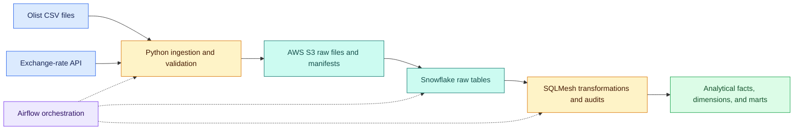
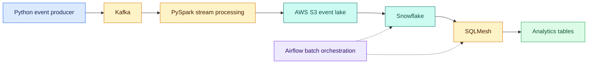
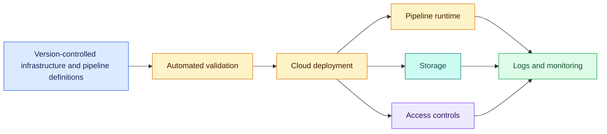

# Canyon White | Data Engineering Portfolio

Data engineering projects focused on reliable ingestion, cloud warehousing, streaming, distributed processing, and infrastructure automation.

Each project connects a practical data problem with an architecture designed to solve it. The retail platform is currently in progress; the other four projects are planned. Architecture diagrams describe the intended complete systems.

**Diagram colors:** Blue = sources · Amber = processing · Teal = storage · Green = outputs · Purple = orchestration and access controls.

## Projects

| Project | Status | Primary goal |
| --- | --- | --- |
| [Retail Data Engineering Platform](#retail-data-engineering-platform) | In progress | Integrate retail data into a reliable analytical warehouse |
| [Video Game Player Telemetry Platform](#video-game-player-telemetry-platform) | Planned | Turn gameplay events into consistent player analytics |
| [Distributed Data Processing with Apache Spark](#distributed-data-processing-with-apache-spark) | Planned | Process large datasets efficiently and measure performance |
| [Change Data Capture Pipeline](#change-data-capture-pipeline) | Planned | Keep analytical data synchronized with transactional changes |
| [Cloud-Native Platform](#cloud-native-platform) | Planned | Make cloud infrastructure reproducible and deployments repeatable |

## Retail Data Engineering Platform

**Status:** In progress · [Repository](https://github.com/canyonwhite/automated-etl-pipeline)

**Scope and goal:** Combine Olist e-commerce records and historical exchange rates into a centralized warehouse supporting sales, customer, product, and payment analysis. Reduce manual data preparation while preserving source records and producing consistent analytical tables.

**Target architecture:**

**Approach:** Validate source files, record checksums and batch metadata, preserve raw data in S3, and load Snowflake before applying SQL transformations. Aggregate order items and payments at the appropriate grain before joining to prevent inflated totals. Use batch tracking, validation, and transaction handling to support repeatable processing.

**Implemented:** CSV validation, batch manifests, S3 upload logic, an orders warehouse loader, unit tests, an initial SQLMesh orders view, and an Airflow smoke-test DAG. Development documentation records a successful Snowflake load of 99,441 orders.

**Next:** Load the remaining datasets, add exchange-rate ingestion, complete analytical models, and connect real pipeline tasks in Airflow. Validate full-workflow retries, replay, and incremental processing. Incremental demonstrations will use historical data replay; the current warehouse loader handles orders with insert-only merging.

## Video Game Player Telemetry Platform

**Status:** Planned

**Scope and goal:** Process simulated gameplay events into datasets for player sessions, engagement, retention, and game performance analysis.

**Proposed architecture:**

**Approach:** Generate reproducible events, distribute them through Kafka, and process them using event timestamps. Preserve raw events for replay, handle late arrivals and duplicates, and build incremental analytical models. Airflow would coordinate historical and batch processing alongside the streaming workflow.

**Goal evidence:** Demonstrate that replayed, duplicated, and out-of-order events produce consistent session and activity datasets.

## Distributed Data Processing with Apache Spark

**Status:** Planned

**Scope and goal:** Process NYC taxi trip records into analytical datasets and measure how processing and storage choices affect runtime and resource use.

**Proposed architecture:**

```mermaid
flowchart LR
    A["NYC taxi trip records"] --> B["AWS S3"]
    B --> C["PySpark ETL"]
    C --> D["Partitioned Parquet"]
    D --> E["Snowflake or DuckDB"]
    E --> F["SQL analysis"]

    classDef source fill:#DBEAFE,stroke:#2563EB,color:#172554
    classDef process fill:#FEF3C7,stroke:#D97706,color:#451A03
    classDef storage fill:#CCFBF1,stroke:#0F766E,color:#134E4A
    classDef output fill:#DCFCE7,stroke:#16A34A,color:#14532D
    classDef control fill:#EDE9FE,stroke:#7C3AED,color:#2E1065

    class A source
    class B,D,E storage
    class C process
    class F output
```

**Approach:** Establish a baseline, then evaluate partitioning, join strategies, shuffles, data skew, and columnar storage. Compare equivalent workloads and validate output correctness before assessing performance differences.

**Goal evidence:** Publish reproducible benchmarks with dataset size, execution environment, runtime, and resource measurements. Performance improvements remain to be measured.

## Change Data Capture Pipeline

**Status:** Planned

**Scope and goal:** Propagate inserts, updates, and deletes from PostgreSQL into Snowflake without repeatedly copying the entire source database.

**Proposed architecture:**

```mermaid
flowchart LR
    A["PostgreSQL transaction log"] --> B["Debezium"]
    B --> C["Kafka"]
    C --> D["Python consumer"]
    D --> E["Snowflake"]
    E --> F["SQLMesh"]
    F --> G["Analytical models"]

    classDef source fill:#DBEAFE,stroke:#2563EB,color:#172554
    classDef process fill:#FEF3C7,stroke:#D97706,color:#451A03
    classDef storage fill:#CCFBF1,stroke:#0F766E,color:#134E4A
    classDef output fill:#DCFCE7,stroke:#16A34A,color:#14532D
    classDef control fill:#EDE9FE,stroke:#7C3AED,color:#2E1065

    class A source
    class B,C,D,F process
    class E storage
    class G output
```

**Approach:** Capture database changes, consume events with explicit ordering and checkpoint behavior, and apply changes to warehouse tables. Test duplicate delivery, interrupted processing, and replay to establish recovery behavior and downstream correctness.

**Goal evidence:** Show that warehouse records converge to the expected source state after updates, deletes, and controlled failures, with documented delivery guarantees and limitations.

## Cloud-Native Platform

**Status:** Planned

**Scope and goal:** Build a reproducible cloud environment for running data pipelines, with repeatable deployment and clear operational visibility.

**Proposed architecture — conceptual; services and tools to be selected:**

**Approach:** Define infrastructure in code, validate changes before deployment, configure permissions and secrets, and collect operational logs. Cloud services, deployment tooling, and detailed acceptance criteria will be selected before implementation.

**Goal evidence:** Demonstrate environment recreation, a repeatable pipeline deployment, and an observable run with documented setup and recovery procedures.

## Delivery priorities

Complete the retail platform first, then expand into the four planned projects. Each project will include architecture, setup instructions, validation evidence, and known limitations. Build order for the planned projects remains to be decided.

[GitHub profile](https://github.com/canyonwhite) · [Current project repository](https://github.com/canyonwhite/automated-etl-pipeline)