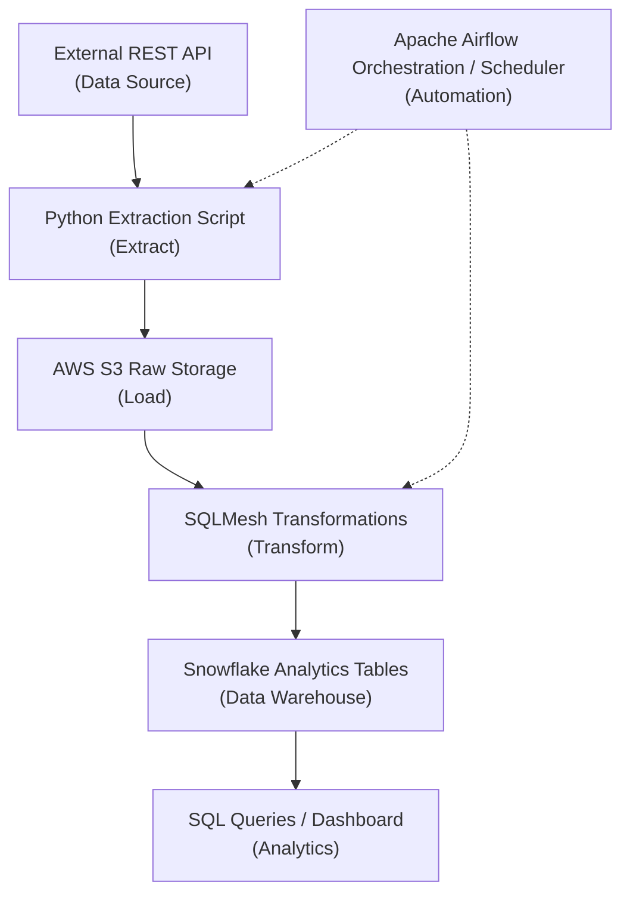

# Automated ETL Pipeline Project
End-to-end automated ELT Pipeline Project.

# Project Description
This data engineering project operates under the following premise:

We work for an e-commerce company which sells thousands of products through an online marketplace. 
The company also collects information about customers, orders, payments, products, and shipping operations.  
However, this information is distributed across several systems:  
- Order information comes from periodic CSV exports
- Customer and product information comes from separate operational datasets
- Exchange rates come from an external REST API
- Business analysts need integrated information in a centralized data warehouse

# Business Problems
**Problem 1:** Data is fragmented
- Information about a single purchase exists across multiple datasets
- Analysts must repeatedly join these datasets to understand what happened

**Problem 2:** Reporting requires manual processing
- Whenver updated information arrives, someone must manually extract, clean, and combine the data

**Problem 3:** Data quality is inconsistent
- Datasets may contain missing values, duplicate records, incorrect types, or unexpected relationships

**Problem 4:** Historical information is difficult to manage
- The business needs consistent historical records while accomodating new information and occasional corrections

**Problem 5:** There is no standardized analytical model
- Different analysts may calculate the same metric differently because there is no centralized definition

# Our Solution
We will build a centralized data engineering platform that automatically:
1. Extracts data from source files and an external API
2. Preserves source data in AWS S3
3. Loads the data into Snowflake
4. Transforms source records into standardized analytical models
5. Validates the resulting data
6. Makes curated tables available for analytics
7. Tracks pipeline execution and identifies failures

# Business Requirements

## Functional Requirements

| ID | Requirement | Description |
| --- | --- | --- |
| FR-01 | File Ingestion | Extract customer, order, product, and payment data from CSV files |
| FR-02 | API Ingestion | Retrieve historical currency exchange rates from an external REST API |
| FR-03 | Raw data storage | Preserve unmodified source data in AWS S3 |
| FR-04 | Warehouse loading | Load source records into Snowflake |
| FR-05 | Data transformation | Transform raw records into standardized relational models |
| FR-06 | Incremental processing | Process new data without unnecessarily reprocessing everything |
| FR-07 | Data quality | Validate schemas, keys, relationships, and business rules |
| FR-08 | Workflow orchestration | Automate and coordinate ingestion, loading, and transformations |
| FR-09 | Error handling | Detect failures and support safe retries |
| FR-10 | Analytical access | Provide curated tables for reporting and downstream applications |

## Nonfunctional Requirements
| Category | Proposed requirement |
| --- | --- |
| Reliability | Failed operations can be safely retried |
| Idempotency | Reprocessing the same source batch does not duplicate business records |
| Performance | A normal incremental batch completes within 10 minutes under our test configuration |
| Data quality | All critical model-level validation checks pass before publication |
| Maintainability | Ingestion, transformation, and orchestration code remain modular |
| Security | Credentials are not stored in source control |
| Observability | Every pipeline run records its status, duration, and record counts |
| Recoverability | Historical batches can be replayed |
| Cost | Keep cloud services within a predefined development budget |

# Data Sources
In this project, we will be using a combination of external API and local CSV file sources.

**Source 1:** [Olist Brazilian E-Commerce Dataset](https://www.kaggle.com/datasets/olistbr/brazilian-ecommerce)
- This dataset contains ~100,000 historical e-commerce orders from 2016-2018

**Source 2:** [Historical Foreign Exchange Rates](https://frankfurter.dev/)
- This source provides historical exchange-rate data through a public REST API without requiring an API key
- We will use this to obtain historical Brazilian reais (BRL) to USD exchange rates

# Initial Architecture Proposal
The project will follow a modern ELT architecture

### Architecture Diagram

### Architecture Components

| Component | Technology | Responsibility |
|-----------|------------|----------------|
| Data Source | REST API | Provides source data |
| Extraction | Python | Retrieves data from the API |
| Raw Storage | AWS S3 | Stores extracted data before transformation |
| Transformation | SQLMesh | Cleans, validates, and models data |
| Analytics Storage | Snowflake | Stores analytics-ready tables |
| Analytics | SQL / Dashboard | Supports querying and visualization |
| Orchestration | Airflow | Automates pipeline execution |

### ELT Workflow

1. **Extract:** Python requests data from the external REST API.
2. **Load:** Extracted records are loaded into raw PostgreSQL tables.
3. **Transform:** SQL or dbt transforms raw records into structured, analytics-ready datasets.
4. **Analyze:** SQL queries or dashboards consume the transformed data.
5. **Automate:** An orchestration tool schedules and monitors pipeline execution.

### Design Principles

- **ELT over ETL:** Raw data is loaded before transformation.
- **Separation of concerns:** Extraction, storage, transformation, and orchestration are independent components.
- **Reproducibility:** Pipeline execution should produce consistent results.
- **Idempotency:** Re-running the pipeline should not introduce duplicate records.
- **Observability:** Pipeline runs should record execution status, errors, and record counts.
- **Scalability:** The architecture should support additional data sources and transformations.

### Initial Technology Stack

- **Python:** API integration and data extraction
- **PostgreSQL:** Raw and transformed data storage
- **SQL:** Data cleaning and transformation
- **dbt:** Data modeling and transformation management
- **Docker:** Local development environment
- **GitHub:** Version control and project documentation
- **Scheduler / Airflow:** Pipeline orchestration in a later phase
